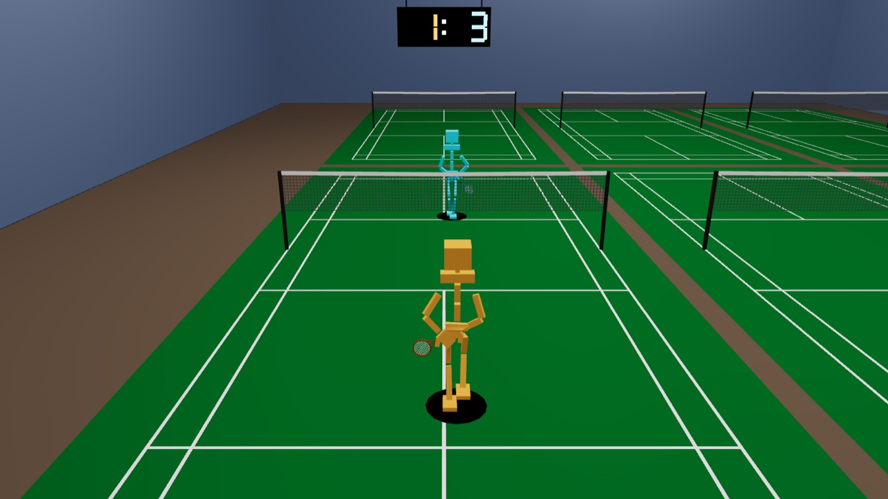
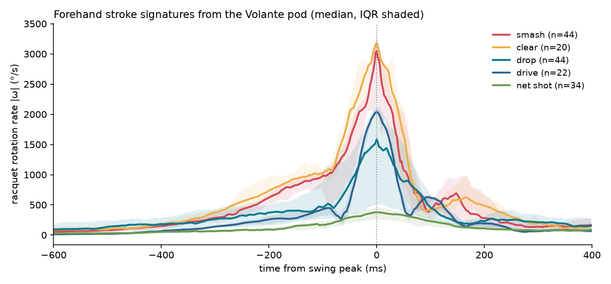
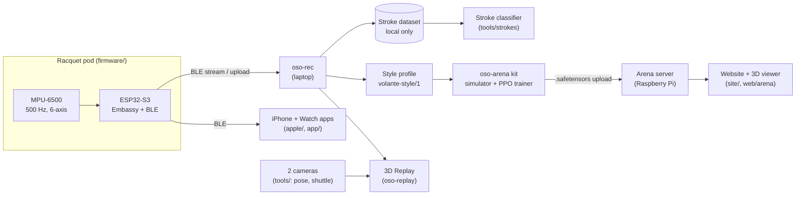

# Volante

**Badminton, measured.** Volante (Spanish for *shuttlecock*) is a racquet sensor pod plus software that turns every swing into
numbers: when you hit, how hard, and what stroke it was. Alongside it, **Volante Arena** is a public game where people train small
neural networks to play badminton and watch them compete on a ladder in 3D.

[](https://github.com/jesusthecreator017/Volante/actions/workflows/ci.yml)

<p align="center">
  
  <br><sub>A real Arena match between two scripted bots, rendered by the Rust/wgpu viewer that also runs in the browser.</sub>
</p>

> [!NOTE]
> Volante is the product name. Crates, binaries, packages, file formats and the pod's Bluetooth name keep the `oso` prefix
> (`oso-rec`, `oso-arena`, `OSO-4C99`).

## What it does

| | What | Status |
|---|---|---|
| **Racquet pod** | A 6-axis IMU in the racquet handle sampling at 500 Hz; streams over Bluetooth LE or records ~12.5 min to on-board flash | Working prototype |
| **Swing tracking** | Detects every swing, times it, and estimates racquet-head speed from the gyro | Available |
| **Stroke recognition** | Classifies 10 strokes (smash, clear, drop, drive, lift, net shot, block/push, net kill, short and long serve) plus forehand/backhand | In development: dataset collected, v0 model in progress |
| **Session summary** | Post-session report: volume, speed, rhythm, rallies, heart rate, trends | In development (iPhone app) |
| **Volante Arena** | Train a badminton AI with the Python kit, upload it, climb an Elo ladder, play weekly tournaments, watch every match in 3D | Live on the team Raspberry Pi |
| **Volante Twins** | Turn your pod sessions into a *style profile* and train an Arena AI that plays with your power, consistency and rhythm | Kit and profile tool done; server ladder in progress |
| **3D Replay** | Rebuild a recorded match in 3D from two cameras plus the pod | Works for recorded matches; not a current focus |

### What the pod sees

<p align="center">
  
</p>

Median racquet rotation around the swing peak for five forehand strokes, from labelled drill sessions recorded with the pod.
Power strokes (smash, clear) spike to about 3,000 °/s within ~100 ms; touch strokes (net shot) barely reach 400 °/s. These shapes
are what the stroke classifier learns from. Each gyro axis saturates at ±2,000 °/s, so the hardest swings are lower bounds.

## Quick start

No hardware needed: simulate an Arena match and watch it in 3D.

> Requires Rust 1.85+ (edition 2024) and Python 3.10+.

```bash
git clone https://github.com/jesusthecreator017/Volante.git && cd Volante

# 1. Install the Arena kit
python3 -m venv .venv && .venv/bin/pip install "./arena/kit[train]"

# 2. Play one match between two scripted bots and turn it into a replay
.venv/bin/oso-arena match bot bot -o match.log --seed 1
.venv/bin/oso-arena animate match.log -o match.bin

# 3. Watch it
cargo run --release -p oso-arena -- --replay match.bin
```

Step 2 prints the result, for example `House Bot 2 - 1 House Bot, 75 rallies, 3.7 simulated min -> match.log`.

## Usage

<details>
<summary><b>Record with the racquet pod</b></summary>

Flash the firmware (XIAO ESP32-S3 with an MPU-6500/9250, async Rust on Embassy; see [firmware/README.md](firmware/README.md)):

```bash
cd firmware && source ~/export-esp.sh && cargo run --release   # build, flash, serial monitor
```

Then talk to the pod from your laptop with `oso-rec` (macOS asks to allow Bluetooth the first time):

```bash
cargo run --release --bin oso-rec -- status               # storage, state, sensor health
cargo run --release --bin oso-rec -- wake                 # the pod sleeps when idle
cargo run --release --bin oso-rec -- calibrate            # once per mount: finds the racquet axes
cargo run --release --bin oso-rec -- live                 # a 3D racquet that follows your swing in real time
cargo run --release --bin oso-rec -- upload -o imu.bin    # download the on-pod recording
```

The pod starts recording on power-on once its previous session has been uploaded. Protocol: [docs/ble-profile.md](docs/ble-profile.md).
</details>

<details>
<summary><b>Collect labelled stroke data</b></summary>

`oso-rec collect` runs a guided drill session: one block per stroke and side, a live rep counter, breaks, and crash-safe resume.
Data stays local in `~/Datasets/oso-strokes/` and never enters the repo.

```bash
cargo run --release --bin oso-rec -- collect --player P07 --handed R --level club
cargo run --release --bin oso-rec -- collect --resume ~/Datasets/oso-strokes/raw/<session>
tools/.venv/bin/python tools/strokes/build_dataset.py      # QC, swing windows, labels -> processed/swings_v1.npz
```

Operator guide: [docs/strokes/collection.md](docs/strokes/collection.md) · consent: [docs/strokes/consent.md](docs/strokes/consent.md) ·
stroke classes: [docs/strokes/README.md](docs/strokes/README.md).
</details>

<details>
<summary><b>Train an Arena player</b></summary>

```bash
.venv/bin/oso-arena train --help                        # PPO self-play (the [train] extra installs torch)
.venv/bin/oso-arena export --help                       # training checkpoint -> .safetensors submission
.venv/bin/oso-arena check my_model.safetensors          # validate against the oso-arena/1 contract
.venv/bin/oso-arena eval my_model.safetensors           # play it against the bot or the base model
```

Rules, observations, actions and stat builds: [arena/contract/CONTRACT.md](arena/contract/CONTRACT.md). Kit guide:
[arena/kit/README.md](arena/kit/README.md). A Claude skill coaches you through training a play style:
[skills/oso-arena-coach](skills/oso-arena-coach/SKILL.md).
</details>

<details>
<summary><b>Make your twin ("play like me")</b></summary>

```bash
cargo run --release --bin oso-rec -- profile ~/Datasets/oso-strokes/raw/<session> -o my_style.json
.venv/bin/oso-arena train --style my_style.json
.venv/bin/oso-arena export --help                       # pass --style my_style.json to embed the profile
```

Only the profile (a few numbers: speeds, consistency, tempo, data volume) leaves your computer, inside the model file. Format and
rules: [arena/contract/STYLE_PROFILE.md](arena/contract/STYLE_PROFILE.md).
</details>

<details>
<summary><b>Run the website and apps locally</b></summary>

```bash
cd site && npm install && npm run dev:mock      # website against a mock API: http://localhost:5173
cd app && npm install && npm run dev            # cross-platform app (web, iOS, Android via Capacitor)
cd apple && xcodegen && open Oso.xcodeproj      # native iPhone + Apple Watch apps (Xcode 26+, see apple/README.md)
```

To watch real matches in the local website, build the browser viewer first with `web/arena/build.sh` (see [site/README.md](site/README.md)).
</details>

## Architecture



- **One renderer, two products.** `crates/oso-render` is a wgpu renderer with a hecs ECS scene. The Replay and Arena apps plug into
  it through the `Extras` trait and build both natively and to WebAssembly (WebGPU, with a WebGL2 fallback).
- **One protocol, four clients.** The pod's BLE protocol lives in `proto/` (shared by the firmware and the Rust tools) and is
  mirrored in Swift (`apple/OsoKit`) and TypeScript (`app/`). [docs/ble-profile.md](docs/ble-profile.md) is the source of truth.
- **One simulator.** The server checks uploads and plays ladder matches with the same kit users train with, and match logs animate
  into the same `replay.bin` format both viewers read. Formats and coordinate systems: [docs/data-format.md](docs/data-format.md).

## Repository map

| Path | Contents |
|---|---|
| [`firmware/`](firmware/README.md) | Pod firmware: XIAO ESP32-S3, Embassy, esp-hal, trouble BLE (own toolchain, outside the workspace) |
| `proto/` | BLE protocol and packet format shared by firmware and host tools |
| `crates/oso-render` | Shared wgpu renderer, scene, playback and replay parsing |
| `crates/oso-replay` | Replay viewer (`oso`), pod recorder (`oso-rec`), IMU fusion (`oso-imu`) |
| `crates/oso-arena` | Arena match viewer (scoreboard, procedural racquet) |
| [`arena/kit`](arena/kit/README.md) · [`arena/contract`](arena/contract/CONTRACT.md) | Python simulator, trainer and CLI · the `oso-arena/1` contract |
| [`arena/handoff`](arena/handoff/README.md) | The bundle and brief for the Pi server |
| [`site/`](site/README.md) | Public website: pod landing page and the Arena (TypeScript + Vite, strict CSP) |
| [`web/`](web/arena/README.md) | Browser builds of the viewers |
| [`apple/`](apple/README.md) · [`app/`](app/README.md) | Native iPhone/Watch apps and the OsoKit Swift core · cross-platform app and LAN server |
| [`tools/`](tools/README.md) | Python: calibration, pose, triangulation, shuttle tracking, stroke dataset |
| [`deploy/pi`](deploy/pi/README.md) | Raspberry Pi deployment |
| `docs/` | Formats, BLE profile, design specs and plans |

## Development

```bash
cargo test --workspace                                       # Rust
cargo clippy --workspace --all-targets -- -D warnings        # the CI lint gate
python arena/kit/tests/run_all.py                            # Arena kit
cd site && npm test                                          # website
node --test web/arena/*.test.mjs                             # viewer JS
cd apple/OsoKit && swift test                                # Swift core (needs Xcode)
```

CI runs each area only when its paths change ([docs/ci.md](docs/ci.md)). Version tags build the kit wheel, the browser viewers, the
Pi bundle and the firmware image ([release.yml](.github/workflows/release.yml)).

## Limitations

- **Sensor range:** the MPU-6500 tops out at ±2,000 °/s and ±16 g. Hard smashes clip, so their speeds are lower bounds.
- **Speeds are estimates** from rotation rate × a 0.53 m lever arm, not radar measurements.
- **On-pod recording** holds about 12.5 minutes; longer sessions are recorded in parts. Battery level isn't measured yet.
- **The stroke model** is trained on one player so far and isn't validated on anyone else's swings.
- **Racquet-only data:** the pod sees racquet motion, not court position or where the shuttle lands.

## Contributing

The repository is private and built by a small team. Every change goes on its own `feature/<topic>` branch with a pull request; the
maintainer reviews and merges, and nothing is committed to `main` directly. Run the checks above before opening a PR.

## License and credits

There is no project-wide license yet: all rights reserved, except the Arena kit, which is [MIT](arena/kit/LICENSE). Third-party
assets and their licences are listed in [CREDITS.md](CREDITS.md). The racquet model used by the Replay viewer has an unknown
licence and isn't shipped with the Arena; it must be replaced before a public release. Stroke datasets are personal data and stay
on the collector's machine.
